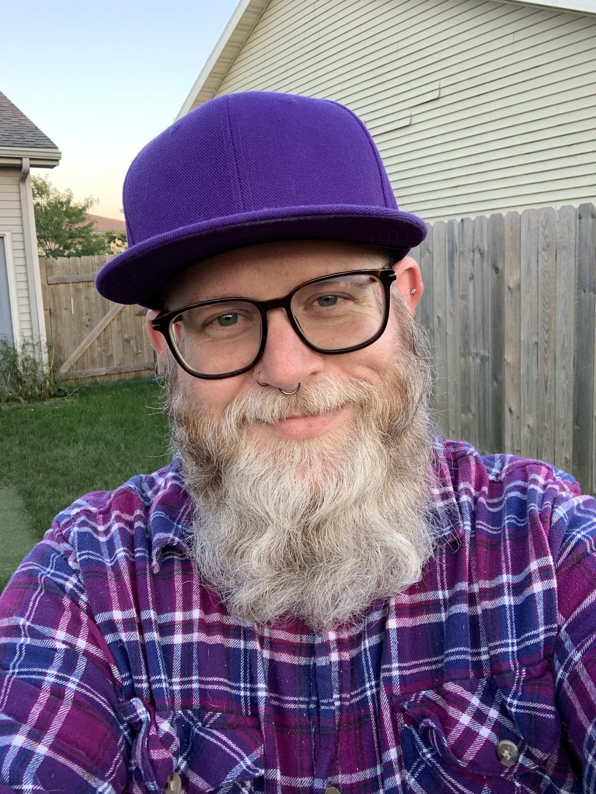
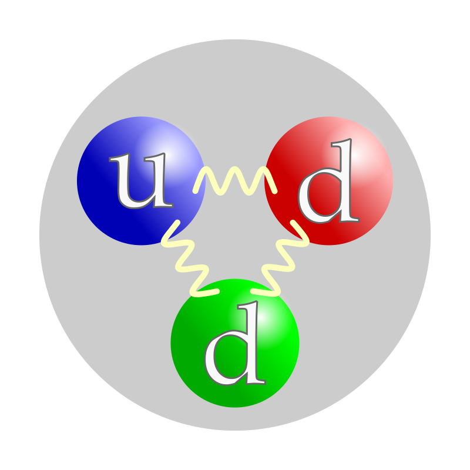
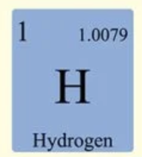
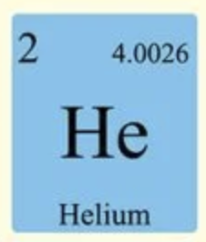
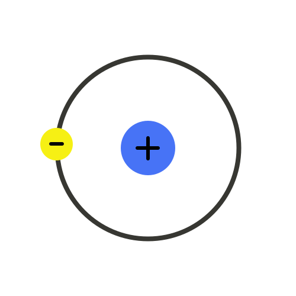
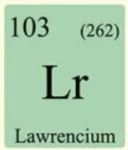
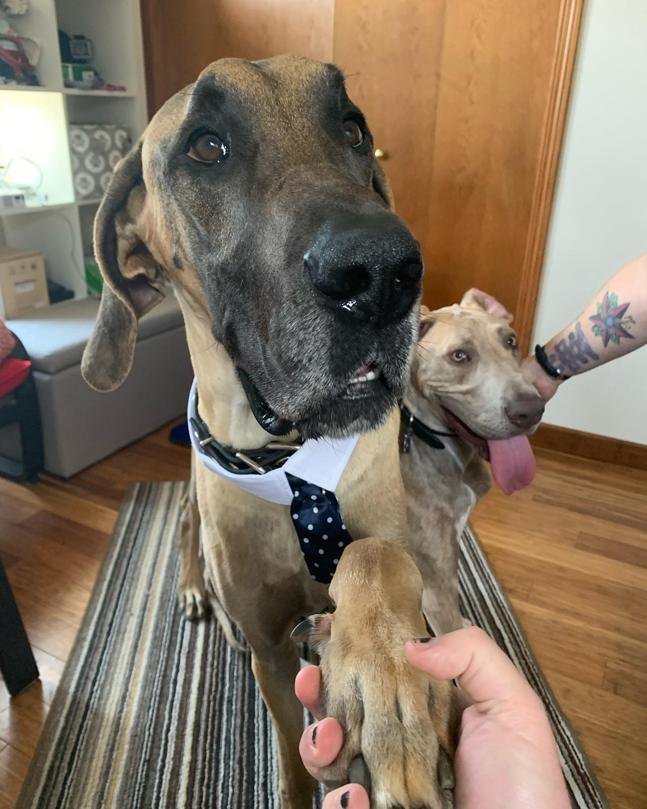

# Beyond the Delay   Building Sustainable Accessibility with  Hub-and-Spoke

---

## Nat Tarnoff

- **Principal Accessibility Consultant**
- **Level Access**
- W3C Accessibility Guidelines Working Group

<!--
Speaker Notes:
"Thanks for being here. Six months ago, the DOJ gave every government entity in this room an extra year to comply with ADA Title II web accessibility requirements. Most of you are probably thinking about how to stretch your current remediation plan across 12 more months. I'm here to tell you that plan is broken — and I want to show you a better way to spend that time."
-->

---

## The Delay Is Not the Story

- **April 20, 2026**: DOJ issues Interim Final Rule
- **Large entities**: April 26, 2027
- **Small entities**: April 26, 2028
- **Standard unchanged**: WCAG 2.1 Level AA
- **Existing Title II obligations still in effect**

<!--
Speaker Notes:
"Let's get the facts straight first. On April 20th, 2026, the DOJ published an Interim Final Rule extending the compliance deadlines by roughly one year. Large public entities now have until April 26, 2027. Smaller ones — small colleges, small jurisdictions — have until April 26, 2028. The technical standard didn't change: WCAG 2.1 Level AA. And critically, your existing obligations under Title II didn't go anywhere. The clock just moved. But here's what nobody is saying out loud: the original timeline already exposed a broken model. The delay didn't fix the model — it just gave you more time to watch it fail slowly."
-->
<!-- 
Visual Suggestion: Timeline graphic showing original April 2026 deadline and extended April 2027/2028 deadlines with WCAG 2.1 AA anchor. -->

---

## Why Centralized Fails at Scale

**One team.  One audit.  One backlog. One bottleneck.**

---

## Failures in action
- **Burnout**: accessibility specialists overloaded
- **Fragility**: key person dependency — they leave, the program wobbles
- **Inconsistency**: different teams, different interpretations, different quality
- **Maintenance gap**: you finish the audit, then what?

<!-- Speaker Notes:
"Here's what I see in nearly every government org I consult with. You have a small accessibility team — maybe one person, maybe three. They're responsible for auditing thousands of pages and applications. They become the bottleneck. Everything routes through them. They burn out. And when they leave, the entire program wobbles because all the knowledge lived in their head. Even if you survive the audit, you've solved nothing for next quarter when a department publishes 200 new inaccessible pages. The centralized model is a project with a finish line. Accessibility doesn't have a finish line." -->

---

## The Bottleneck by Numbers

- **Average government website**: 5000+ pages
- **Typical accessibility team**: 1–3 people
- **Average remediation rate**: 50–100 pages/month (centralized)
- **At that pace**: 5000 pages = 5-10 years

> The Math Doesn't Math

---

## What is Hub & Spoke?

---

## The Hub: Central Accessibility Team

- Governance, standards, tooling, training, escalation
- Enables — doesn't execute all work

---

## The Spokes: Embedded Champions in each department

- Implement, test, maintain accessibility in their context
- First line of defense, supported by the hub

---

# Shift from "doing accessibility TO"  →  "building accessibility WITH"

---

<!-- backgroundImage: url("periodic-table-of-elements-scaled.webp"); -->

## Atomic Hub & Spoke Model

---
<!-- backgroundImage: none; -->

## How Does the Atom apply?

- Hub & Spoke doesn't detail what is needed at each moment.
- Atoms are made of Electrons, Protons, and Neutrons. 
- These particles are made of quarks. 
- This allows us to be more specific in what each item does and how it affects the whole.

---

## Quarks

Quarks are the tools & knowledge we use to implement accessibility, like:

- Assistive Technology
- WCAG rules and best practices
- Client Support
- Training
- Linters & Continuous Integration testing
- Testing tools & processes

---

## Protons work in the Hub

---

## You are a proton.

- You bring the positive energy and a combination of quarks that make you required to the execution of accessibility.
- Your job is to define policies, methods, and accountability strategies, train, support, test, and answer questions.

>Protons build the Neutrons from the quarks available

---

## Neutrons are Knowledge & Process

### IN WRITING and AVAILABLE to others

- Neutrons are the policies, guardrails, and methodologies implemented.
- These are very stable and neutral as they just serve to define "done".
- Neutrons beyond personal expertise should be documentation in the company intranet.

---

## Nucleus is the Hub

- Most companies start out with one Proton.
- They create their needed Neutron to build the nucleus of your program. 
- As time, growth, and complexity evolve, the nucleus will need to add additional protons and Neutrons.

---

## Electrons are the Spoke People

---

## Electrons

- Electrons are the groups and individuals who will execute the decisions of the nucleus. Most electrons will need assistance to achieve done.
- Electrons hop from atom to atom. When one leaves, there is energy lost and instability occurs.
- A good electron is one who puts accessibility practices into daily work.

>Keep skilled Electrons incentivized to stick around. Or make them Protons.

---

## Nuclear Forces

### There is a limit to how many electrons a nucleus can support as it tries to stay in balance

- When an electron leaves, one must replace it or accessibility will fall down.
- When a Proton leaves, there is more energy released.
- They take a big chunk of Quarks with them that may harm the Neutrons.
- Electrons will lose control and switch atoms causing your accessibility to slip.

---

## Building Complex Atoms

- An atom with one proton and one electron can only support a few small or one large project.
- For efficiency, and staying ahead of lawsuits, you need to have a goal of one proton & one electron for every project.
<!-- Speaker Notes: 
 This doesn't mean each person has only one project, but you have coverage for that support if needed. Each proton will be contributing to the Neutrons creating more stability. -->
- Each team needs an Electron. This is their primary contact for all accessibility issues. 
<!--  Speaker Notes The electron doesn't need to be an expert, but knows who to go to if they don't. Strong programs will have lots of free floating electrons.-->

---

## Molecules

**The more complex the organization, the more complex the governance will be.   It may make sense to build several smaller atoms that work together for wider coverage.**

---

## Where do I Start?

**Inventory your digital properties and exposure**
    - Identify stakeholders and spoke people
    - Set a Charter. **Know what done means**

**Train & Pilot**
    - Develop training curriculum
    - Pilot it with 1 - 3 teams
**Expand & Iterate - Enroll more teams and improve the flow.**

**Deploy & Transition - Hub shifts from "doing" -> "enabling"**

---

## Keeping Up

- **WCAG evolves: 2.1 → 2.2 → 3.0**
- The model absorbs new standards without restructuring
- Spokes adapt locally
- Hub updates governance centrally
- Disabled users get continuous improvement, not audit-day fixes
- Culture shift: "how we build" not "what we fixed"

---

## No Program?

### You just started one by showing up to this talk!

- Find a consultant to guide you
- Read WCAG and WAI-ARIA specifications
- Learn about Universal Design Language
- Establish goals, timelines, and budget
- Know it is a process. Conformance takes time.
- Know the applied laws. **Conformance and Compliance are two different beasts.**

---

# Accessibility is about **people**,  not **compliance**

---

## Reminders

- Disabled constituents depend on government services daily
- Benefits access, transit info, court filings, emergency alerts
- **Centralized model** = episodic attention to people's needs
- **Atomic Hub-and-spoke** = continuous, distributed accountability

---

## Where is your Team at?

- How many people per project to execute, organize, and test?
- What and where is the Source of Truth for your developers to review?
- What is your software development lifecycle? Does it include accessibility testing?
- Do developers test their own stuff?
- Do you self-test and certify or use a third party?

---

## Ensure the following

- Accessibility statement including the level you were tested against and a method to contact your team
- Governance policy including enforcement rules
- Procurment prolicies to ensure accessible tooling
- Process for seeking accessibility support internally
- including accessibility support and testing at all stages from business analyst to launch
- Include disabled people in the consultation, design, and testing

---

## Things to Watch Out For

### A few places where people might push back:

- **"We can't afford to train spokes"** — You can't afford not to. The cost of perpetual remediation dwarfs the cost of building capability. Frame it as compliance vs. operations.
- **"Our org is too siloed"** — That's exactly why you need spokes in the silos. The hub bridges them; it doesn't eliminate them.
- **"This sounds slow"** — It's faster than centralized remediation at scale. Pilot results in 6 months beat a 47,000-page backlog in 12.

___

# Q & A

---

# Thank You!

## Nat Tarnoff

- **Principal Accessibility Consultant**
- **Level Access**
- W3C Accessibility Guidelines Working Group
- **nat.tarnoff@levelaccess.com**
- https://tarnoff.info

